# PracticeHub — Guida per chi la usa

*Versione del 09/10/2026. Schermate della versione definitiva con dati dimostrativi. Hai un problema o un dubbio? Scrivi a **operations@hqe.it**.*

---

## 1. Che cos'è

PracticeHub raccoglie in un solo posto le pratiche dei siti che gestiamo per i nostri clienti (ILIAD, TOWERNET, TIM/FIBERCOP, INWIT, FASTWEB-VODAFONE, LEONARDO) e sostituisce i fogli Excel dei team.

Ogni pratica ha una **scheda** divisa per gruppo di lavoro:

| Gruppo | Chi ne fa parte |
|---|---|
| **PM/Permessi** | PM e Permessi |
| **UT/PE** | Ufficio Tecnico e Progettazione Esecutiva |
| **AIE** | AIE |
| **DL** | Direzione Lavori |

Ogni gruppo compila i propri campi; i campi degli altri gruppi li vede in sola lettura. La scheda di ogni cliente ha i campi del suo foglio di lavoro.

## 2. Accedere

1. Apri l'indirizzo dell'app che ti è stato comunicato.
2. Inserisci email e password, poi **Accedi**.
3. La prima volta ricevi una mail di **invito**: apri il link e scegli la tua password (il link vale 24 ore; se è scaduto, chiedi all'amministratore di reinviarlo).
4. Password dimenticata: dalla pagina di accesso, **Password dimenticata?**, e segui il link che ricevi via mail.

Se l'amministratore ti ha dato una password provvisoria, al primo accesso devi cambiarla: finché non lo fai vedi solo la pagina di cambio password.

Vedi solo i clienti su cui lavori. Se ti manca un cliente o un gruppo, scrivi a operations@hqe.it.

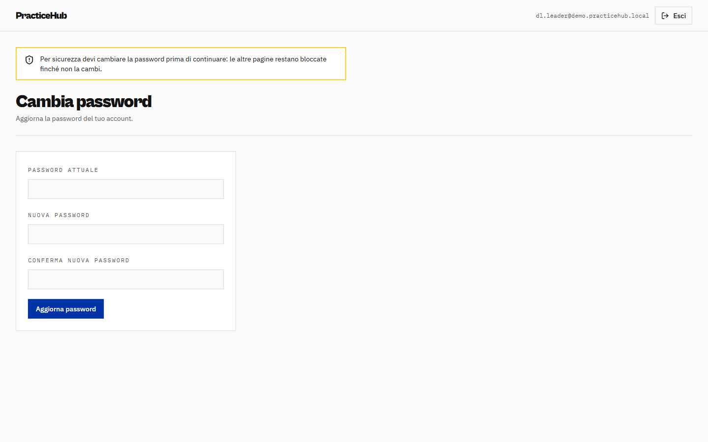

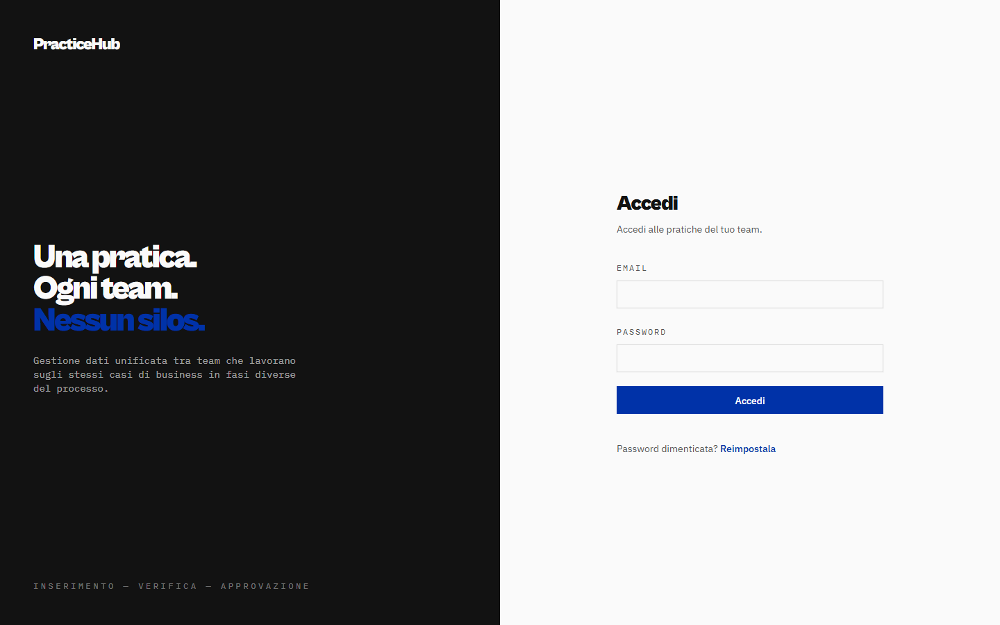

## 3. L'elenco delle pratiche

Nella barra a sinistra scegli **un cliente** oppure **Tutti i clienti**.

- **Cerca** per Codice Sito, Nome Sito o Codice G7.
- **Filtra** per cliente, Stato attività e **data di creazione** ("Creata dal" / "Creata fino al"); **Ordina per** sceglie l'ordine (di solito prima le pratiche aperte).
- **Anche non assegnate**: di solito vedi le pratiche su cui il tuo gruppo è stato attivato; con questa opzione vedi tutte quelle del cliente (in sola lettura quelle non tue).
- Le colonne mostrano stato, avanzamento per gruppo (barre) e, in rosso accanto al Codice Sito, gli **alert aperti**.
- **Esporta CSV**: scarica in un file per Excel le pratiche che stai vedendo, con i filtri attivi (serve scegliere un cliente).
- **Aprire sempre la stessa vista**: imposta i filtri e salva la pagina nei **preferiti** del browser; il preferito riapre esattamente quella vista.
- **Condividere un elenco filtrato**: i filtri finiscono nell'indirizzo della pagina; copialo e mandalo a un collega, che vedrà lo stesso elenco (sempre con i propri permessi). Cliccando un cliente nel menu a sinistra l'elenco si apre senza gli altri filtri: per cambiare cliente tenendo i filtri usa il campo **Cliente** della barra dei filtri.

Le pratiche archiviate non sono nell'elenco: le trovi in **Archivio** (§9).

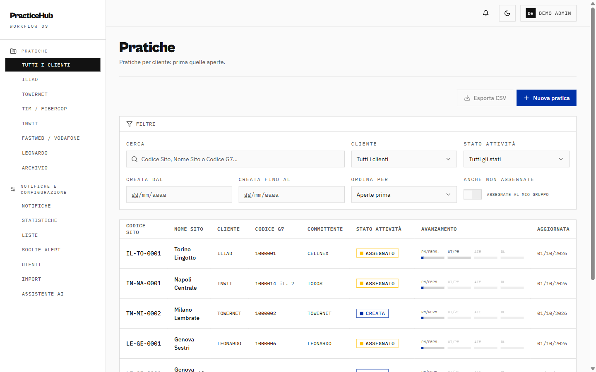

## 4. Creare una pratica (PM e amministratori)

1. **Nuova pratica**.
2. Compila i campi obbligatori: **Codice G7, Codice Sito, Nome Sito, Committente, Cliente Finale**.
3. Il cliente (template) si sceglie da solo in base a Cliente Finale e Committente; se la combinazione non basta, scegli tu fra quelli proposti.
4. Se esiste già una pratica con gli stessi dati, compare un **avviso** con il collegamento per aprirla: puoi crearne comunque un'altra spuntando la conferma.
5. **Crea pratica**: si apre la scheda. Lo Stato attività è **CREATA**.

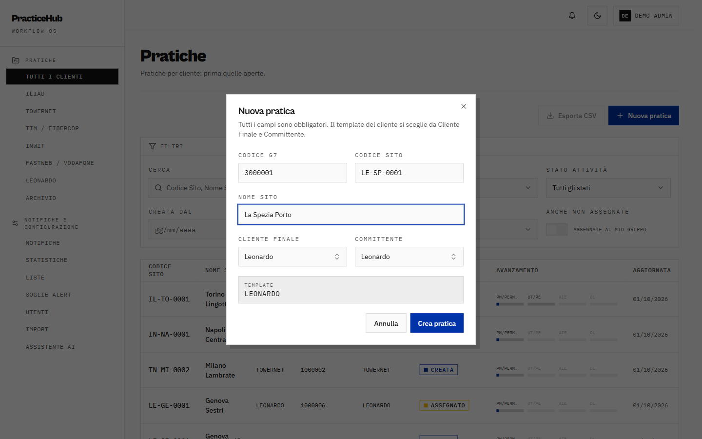
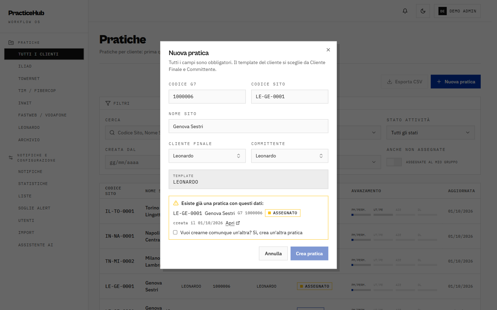

## 5. La scheda della pratica

### In alto
- **Intestazione**: Codice Sito, Nome Sito, Stato attività, cliente, Codice G7, iterazione, eventuale pratica d'origine.
- **Comandi** (compaiono solo quelli che puoi usare): Assegna, Stato attività, Altre azioni (Archivia, Ripristina, Rilavorazione, Ripresentazione totale, Cancella).
- **Alert aperti** (riquadro rosso), vedi §7.
- **Note Operative**: ogni gruppo ha la **sua** nota, che vede e modifica solo il proprio gruppo; PM leader e amministratori le vedono tutte.
- **Fatturabile** e **Fatturato** (li modificano PM e amministratori). Fatturabile diventa **SÌ** da solo 30 giorni dopo l'Ottenimento Permessi se l'ultimo esito ARPA è Positivo; se lo imposti a mano, il calcolo automatico si ferma; un nuovo esito ARPA Negativo lo riporta comunque a NO.

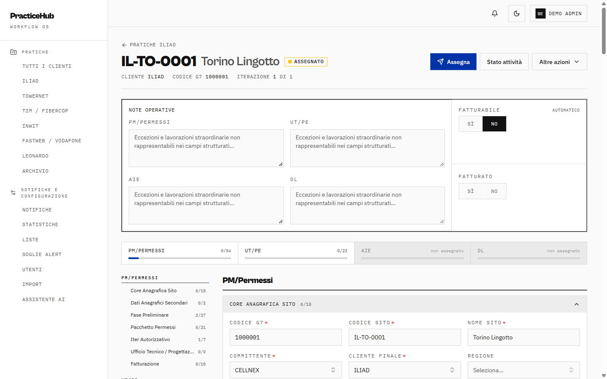

### Le sezioni
- Le sezioni sono raggruppate per gruppo e si aprono e chiudono; a sinistra c'è l'**indice** con i contatori di compilazione e un punto rosso dove ci sono alert. In fondo all'indice, separate dai gruppi, ci sono **Commenti (n)** e **Storico**: un clic porta al riquadro. L'indice resta visibile anche con lo zoom del browser al 200%.
- Un campo con il **lucchetto** non è modificabile da te; il motivo è scritto sotto (per esempio "Compilato da UT/PE", "Il tuo gruppo non ha ancora ricevuto l'Assegna", "Calcolato: …").
- Alcuni campi **compaiono solo in certe condizioni** (per esempio i campi AIE solo se AIE = SÌ). Se nascondi un campo cambiando la condizione, il suo valore resta salvato e ricompare.
- I **riquadri incorniciati** (pop-up) mostrano in sola lettura dati di un altro gruppo utili al tuo lavoro.
- Alcuni dati si **ripetono** (Tenant, Integrazioni, Enti, ODA, cicli ARPA): usa **Aggiungi** per una nuova riga.
- La **tabella Vincoli** ha sempre le stesse 11 voci: per ognuna scegli lo stato e, se serve, l'ente. Se un vincolo è **Presente**, nasce da sola la voce corrispondente nel gruppo Enti.
- **Regione → Provincia → Comune**: scegli nell'ordine; cambiando la Regione, Provincia e Comune si svuotano.
- Alcuni campi si **calcolano da soli** (per esempio Forecast Geologica, Tipologia attività PE). In TOWERNET, INWIT e LEONARDO il **Forecast Ottenimento Permessi** si calcola dal Protocollo; quando salvi per la prima volta un Invio integrazione, se mancano al massimo 15 giorni al forecast, si sposta in avanti di tanti giorni quanti ne separano Richiesta e Invio. Se lo correggi a mano, da quel momento il calcolo si ferma. Quando l'app ricalcola una data te lo dice con un messaggio.

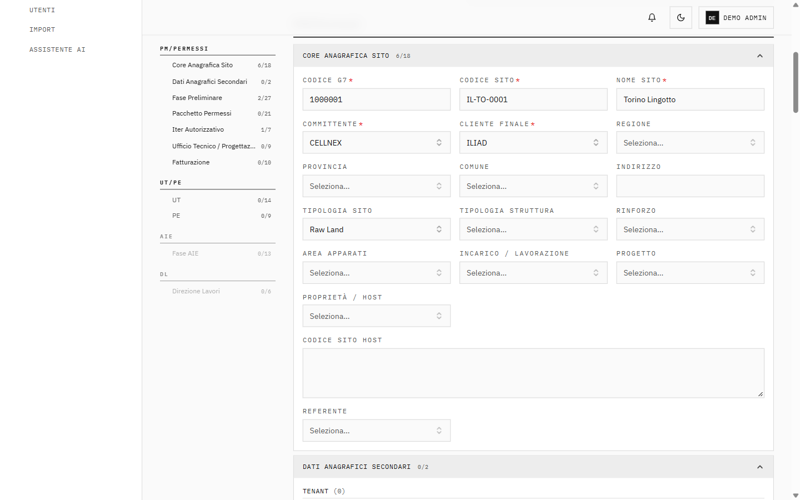
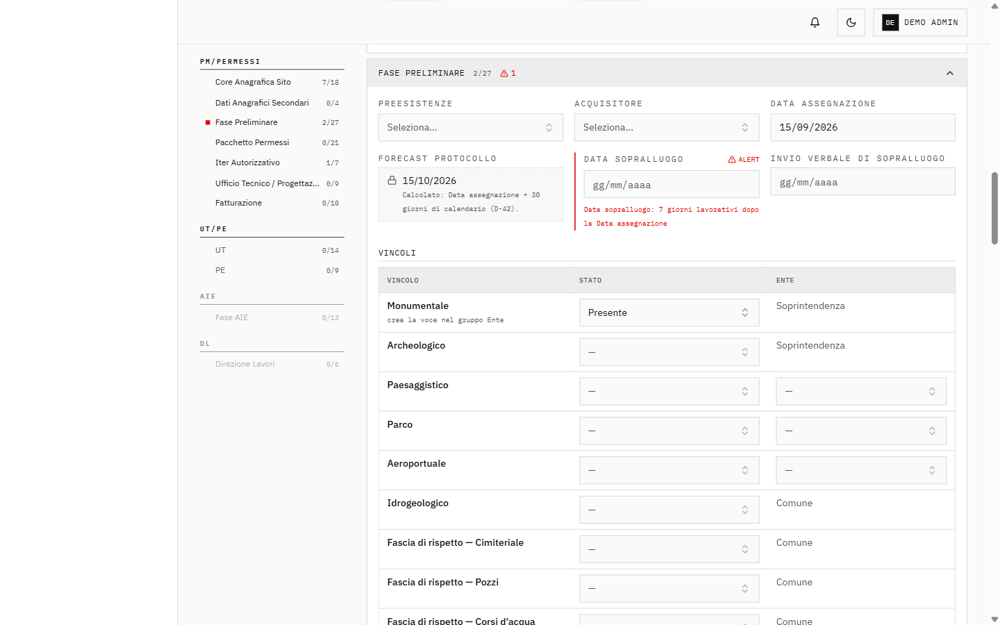
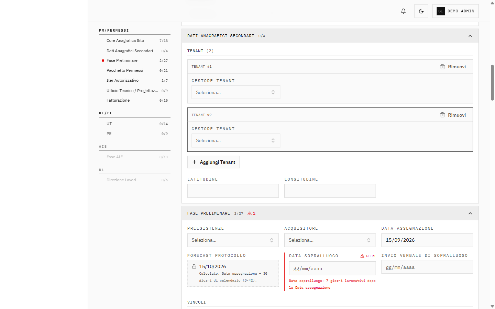
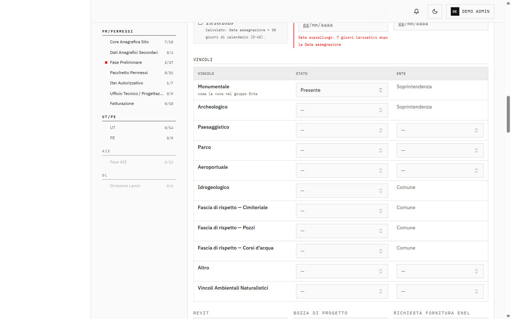

### Salvare
- Le modifiche si accumulano nella barra in basso: **N modifiche non salvate · Annulla · Salva**.
- Se un collega ha salvato la stessa pratica nel frattempo, l'app ricarica i dati e **conserva le tue modifiche non salvate**, così puoi riprovare.
- Aggiungere o togliere una riga si salva subito.

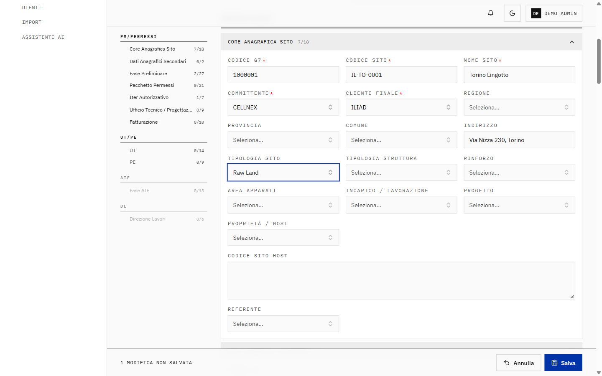

### Lo storico
In fondo alla scheda: **Modifiche ai campi** (valore vecchio → nuovo, chi e quando; "Sistema" per i calcoli automatici, "Import" per i dati importati) e **Attività** (Assegna, cambi di stato, alert…).

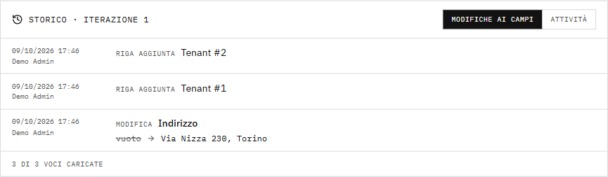

### I commenti
- In fondo alla scheda, sopra lo storico, c'è il riquadro **Commenti**; nell'intestazione il segno "**n commenti**" ci porta. Li legge **chiunque vede la pratica**: servono a coordinarsi fra gruppi. Per le cose interne del tuo gruppo usa la tua **Nota Operativa**.
- Scrivi nel campo e premi **Invia** (o Ctrl+Invio). Testo semplice: vai a capo per un nuovo paragrafo, inizia la riga con "- " per un elenco.
- **Menzioni:** scrivi **@** e scegli dal menu un gruppo (es. **@UT/PE**), **@tutti** (chi lavora su quel cliente) o una persona. Chi è menzionato riceve una **notifica** e una **mail** con il collegamento (la mail non contiene il testo del commento).
- **Rispondi** apre una risposta sotto il commento. Puoi **modificare** i tuoi commenti (compare "modificato") ed **eliminarli**; un amministratore può eliminare qualunque commento. Resta la scritta "Commento eliminato da …" e le risposte non spariscono.
- I commenti appartengono all'iterazione in cui sono scritti; con **Tutte le iterazioni** vedi anche quelli delle precedenti. Su pratiche archiviate o iterazioni passate si possono solo leggere.
- Aprendo la notifica di una menzione, la scheda si apre sul commento e lo evidenzia per qualche secondo.

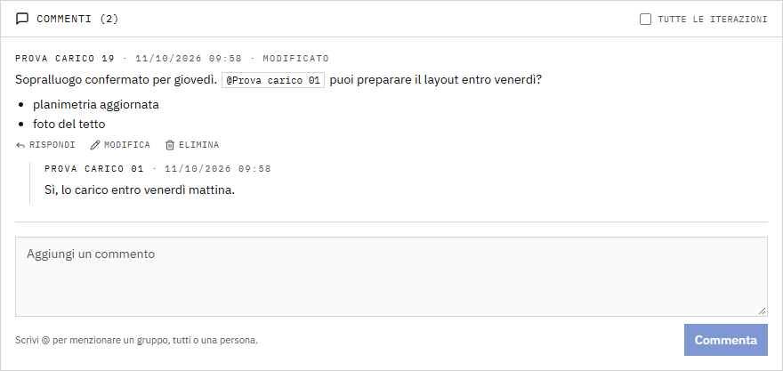
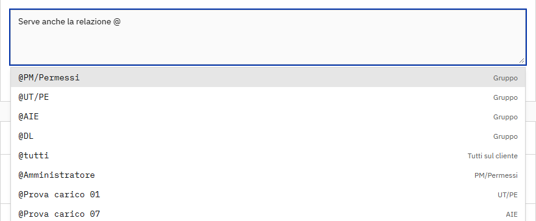

## 6. Assegnare la pratica ad altri gruppi

1. Compila e **salva** prima i campi di assegnazione nella sezione PM (data, forecast, note).
2. **Assegna** → scegli uno o più gruppi (AIE, UT/PE, DL) → eventuale nota per la mail → conferma.
3. Tutti i colleghi dei gruppi scelti ricevono una **notifica** e una **mail**; da quel momento possono lavorare sulle loro sezioni. Assegnando UT/PE viene avvisato anche il gruppo DL.
4. Assegna non toglie nulla a chi assegna: tutti continuano a lavorare sulla pratica.

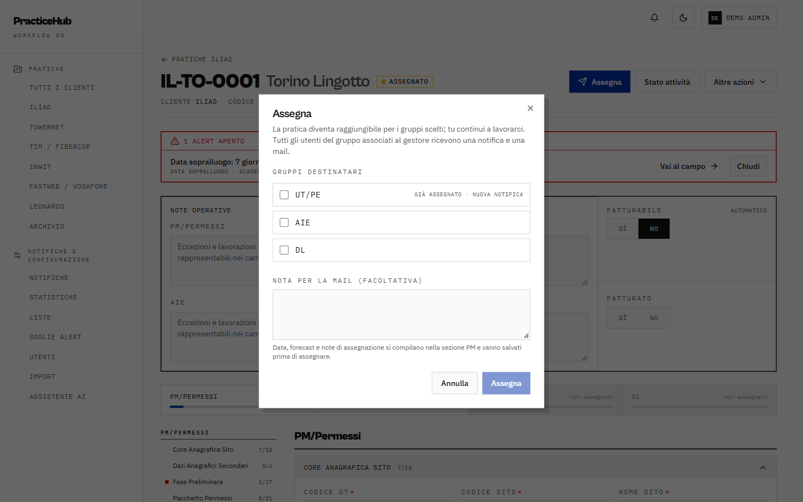

## 7. Alert, notifiche e promemoria

- Gli **alert** segnalano scadenze del flusso (per esempio sopralluogo non fatto 7 giorni lavorativi dopo la Data assegnazione, Forecast UT a 2 giorni senza Invio AS/VS, Forecast Permessi superato). Si contano **giorni lavorativi** (festività nazionali escluse). Se una scadenza è già passata quando salvi, l'alert si apre subito; altrimenti lo apre il controllo delle **09:00**.
- Le notifiche degli alert vanno ai **PM leader** del cliente e ai **team leader del gruppo** competente; gli altri vedono l'alert nella scheda e nell'elenco.
- Un alert **si chiude da solo** quando compili il campo che lo risolve. Alcuni si chiudono **a mano** (pulsante **Chiudi**, per i team leader competenti e gli amministratori): per esempio "Offerta → ODA" quando sono arrivati tutti gli ODA previsti.
- **Pratica KO**: compare l'alert "decidere se è fatturabile"; si chiude **solo** decidendo Fatturabile (SÌ o NO) in cima alla scheda.
- La **campanella** mostra le notifiche (Assegna, alert, promemoria, menzioni nei commenti); il clic porta al punto della pratica. **Leggere una notifica non chiude l'alert.**
- Due alert (Forecast UT, Forecast AIE) arrivano anche **via mail**, agli stessi destinatari, solo nei giorni lavorativi dalle 09:00.

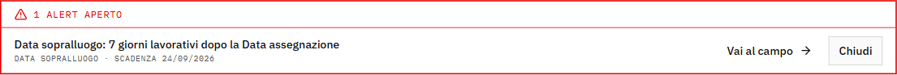
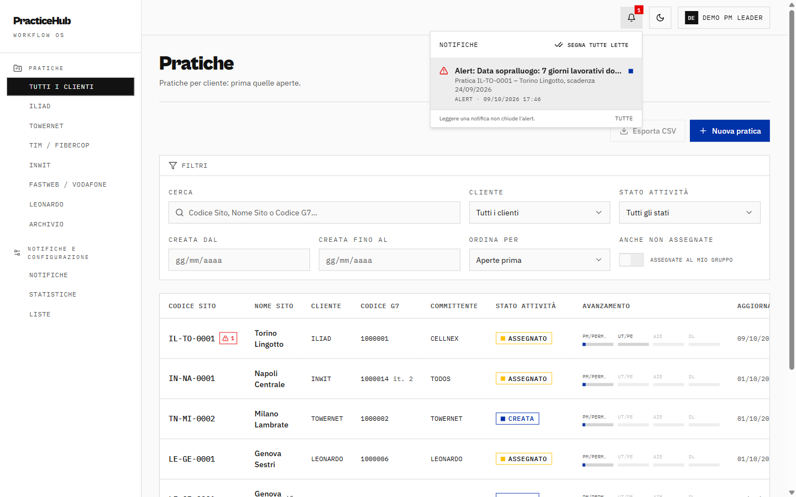

## 8. Stato attività

- Lo stato cambia **da solo** quando si compilano i campi che lo determinano: Data assegnazione → ASSEGNATO, Protocollo → PROTOCOLLATO, nuova Richiesta integrazione → INTEGRAZIONE RICHIESTA, Data FL → REALIZZATO; in TOWERNET e INWIT anche AUTORIZZATO / DINIEGATO / TAR / KO dall'Autorizzazione finale, compilata insieme alla sua data.
- PM e amministratori possono impostarlo **a mano** (**Stato attività**): resta così finché un nuovo evento automatico non riprende il controllo.
- **Completare** la pratica significa impostare **TERMINATO**.

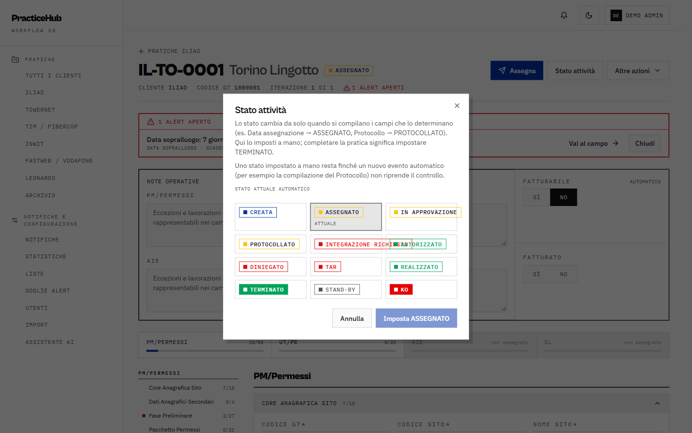

## 9. Archivio, ripresentazione, rilavorazione, cancellazione

- **Archivia** (PM, DL, amministratori; solo con stato TERMINATO o KO): la pratica va in **Archivio**, diventa di sola lettura e i suoi alert si fermano. **Ripristina** (PM, amministratori) la riporta nell'elenco; lo stato non cambia.
- **Ripresentazione totale** (PM leader, amministratori): apre una **nuova iterazione** della stessa pratica. Core e Dati Secondari restano (tranne Codice G7, ODA, Note ODA, Stato ODA), le sezioni operative ripartono vuote, Note Operative restano, Fatturabile torna NO e Fatturato si azzera; lo stato riparte da CREATA. Le iterazioni precedenti restano consultabili in sola lettura dal selettore "Iterazione n".
- **Rilavorazione** (PM, amministratori): crea una **nuova pratica collegata** a questa, con il Core copiato (senza ODA); la pratica d'origine resta com'è.
- **Cancella** (PM, amministratori): solo pratiche ancora in CREATA e **mai ripresentate**. È definitiva: per sicurezza si scrive il Codice Sito.

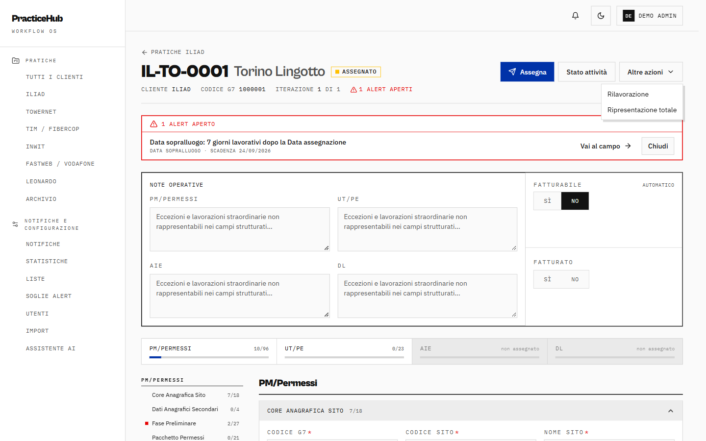
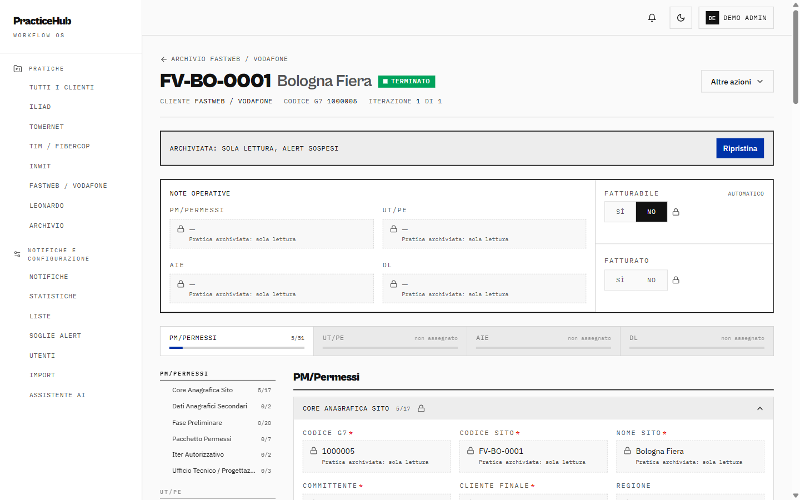

## 10. Statistiche e carichi di lavoro

- **Statistiche** (PM e amministratori): pratiche attive, per stato, cliente, gruppo e assegnatario; alert aperti e scaduti; scadenze dei prossimi 7 giorni; pratiche terminate e KO nel periodo; tempo medio dalla Data assegnazione a TERMINATO.
- **Carichi di lavoro**: per persona e gruppo; i team leader vedono il proprio gruppo, PM e amministratori tutti. Gli elenchi sono in ordine di nome: non sono classifiche.

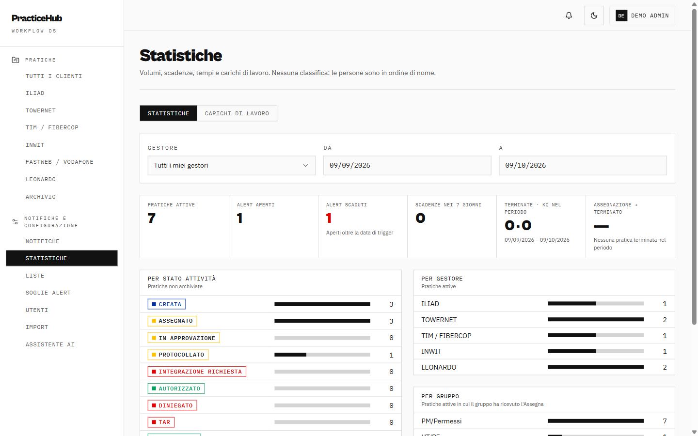
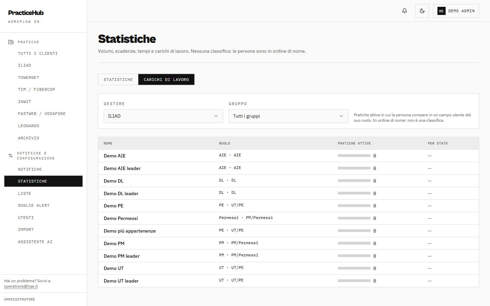

## 11. Configurazione (team leader e amministratori)

- **Liste**: i valori dei menu a tendina del tuo gruppo e cliente. Puoi aggiungere voci, riordinarle, correggerne l'etichetta, disattivarle. Una voce già usata in una pratica **non si cancella**: si disattiva.
- **Soglie alert** (amministratori): i giorni di ogni regola per cliente; valgono per gli alert non ancora emessi.
- **Utenti** (amministratori): invito, modifica delle appartenenze (cliente, gruppo, ruolo, team leader), disattivazione, **Reinvia invito**. Ogni cliente in uso deve avere almeno un **PM leader**. Deve restare sempre almeno un **amministratore attivo**. La casella **Direzione** dà a una persona la pagina Andamento e le Statistiche di tutti i clienti (§13).
- **Assistente AI** (amministratori): interruttore **Assistente attivo per tutti** (vale subito) e **limiti per persona**: domande al giorno (1–100, iniziale 30) e al minuto (1–10, iniziale 4). Ogni modifica è registrata.
- **Soglie alert → Andamento** (amministratori): dopo quanti giorni nello stesso stato una pratica è «ferma» (1–365, iniziale 30; §13).
- **Import** (amministratori): carica un file Excel, controlla l'**anteprima** (cosa verrebbe creato, aggiornato o rilavorato; i campi già compilati **non vengono mai sovrascritti**), scegli la pratica giusta per le righe ambigue, poi **Conferma**.

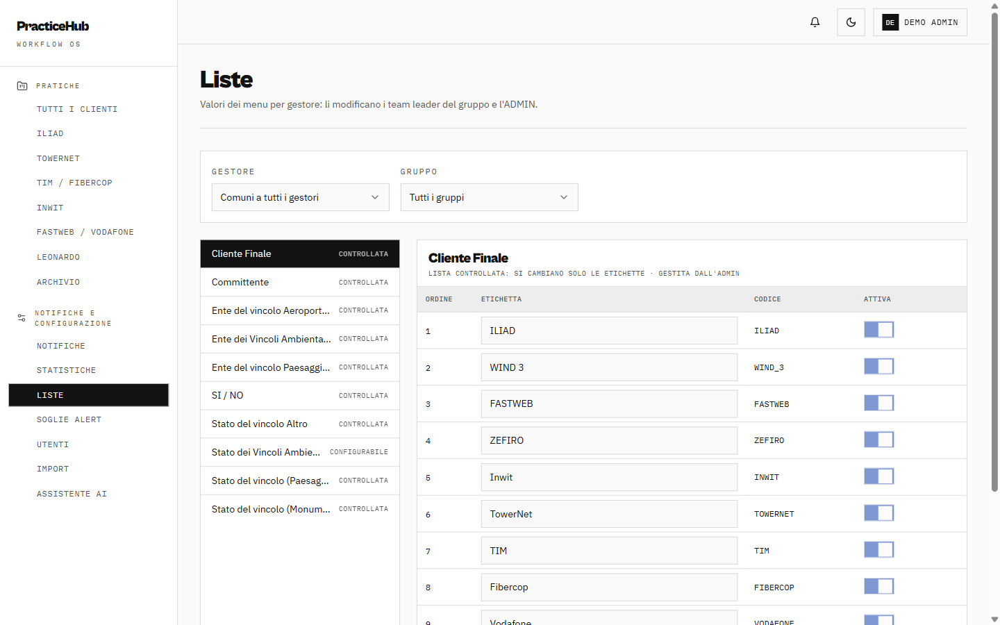
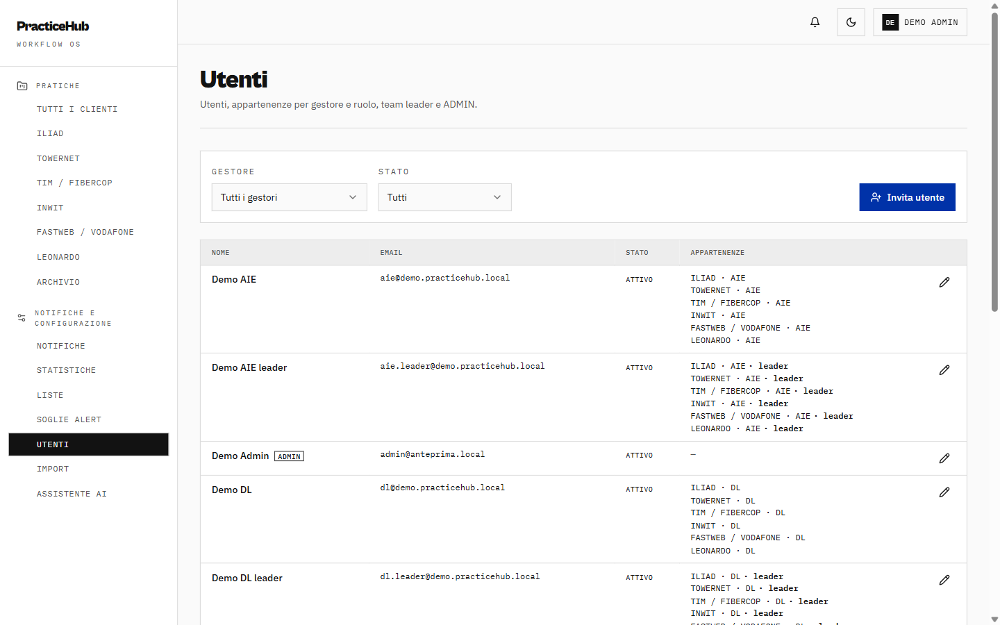
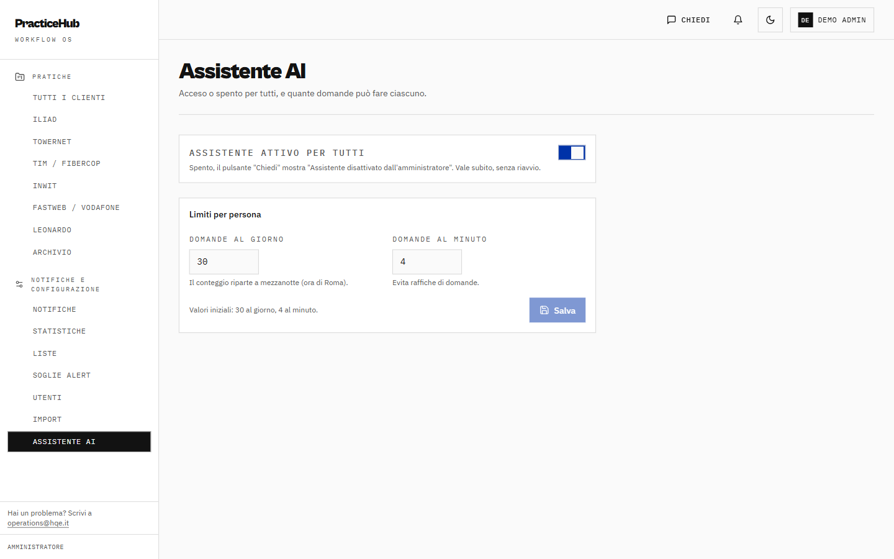
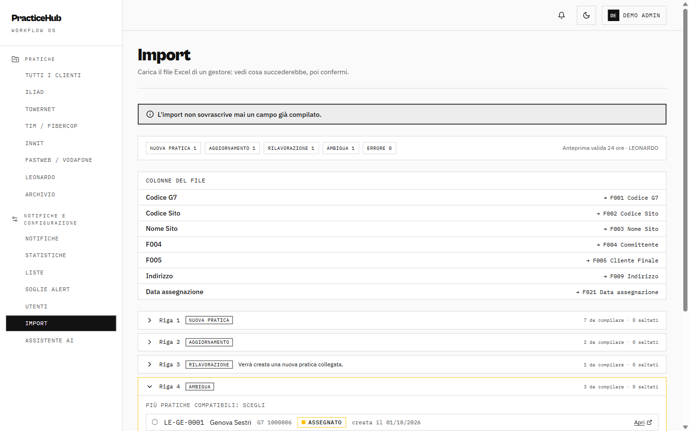

## 12. L'assistente AI

L'assistente risponde a domande in italiano sulle pratiche **che puoi già vedere**. È in **sola lettura**: non modifica nulla.

- **Aprirlo:** pulsante **Chiedi** accanto alla campanella (o Ctrl+K). Si apre un pannello a destra che resta aperto mentre navighi; **Apri a tutta pagina** lo mostra a tutta larghezza. Se l'amministratore l'ha spento, vedi "Assistente disattivato dall'amministratore."
- **Chiedere:** scrivi e premi Invio. Sopra il campo vedi il **contesto** (la pratica o l'elenco della pagina in cui sei): la domanda si riferisce a quello; puoi toglierlo con la X. Con il pannello vuoto trovi le **domande suggerite** per il tuo ruolo: un clic le mette nel campo, puoi modificarle prima di inviarle.
- Esempi: "Quali pratiche ILIAD hanno il Forecast Ottenimento Permessi entro fine mese?", "Le mie consegne previste entro venerdì.", e sulla scheda "Riassumi questa pratica." o "Perché non è avanzata, dalle note visibili?".
- **Leggere la risposta:** il testo compare man mano. I numeri tra riquadri e l'elenco **FONTI** aprono la pratica, l'elenco o le statistiche da cui viene l'informazione; le cifre in **DATI DELL'APP** sono calcolate dall'app, non dall'AI. In fondo trovi l'ora in cui sono stati letti i dati. **Le risposte possono contenere errori: verifica sulla scheda.**
- Se non ci sono dati sufficienti l'assistente lo dice ("Non trovo dati per rispondere.", "Serve una precisazione: rispondi qui sotto."); con **Interrompi** fermi una risposta.
- **Limiti:** ognuno ha un numero di domande al giorno (il contatore, es. "12/30 oggi", è sotto il campo; riparte a mezzanotte) e al minuto.
- **Conversazione:** fino a 8 domande; **Nuova conversazione** ricomincia. Non c'è uno storico: chiudendo il browser o dopo circa 15 minuti di inattività la conversazione si perde.
- Se l'assistente non è disponibile, il resto dell'app funziona normalmente.
- Una risposta sbagliata? Mandala con una schermata a **operations@hqe.it**.

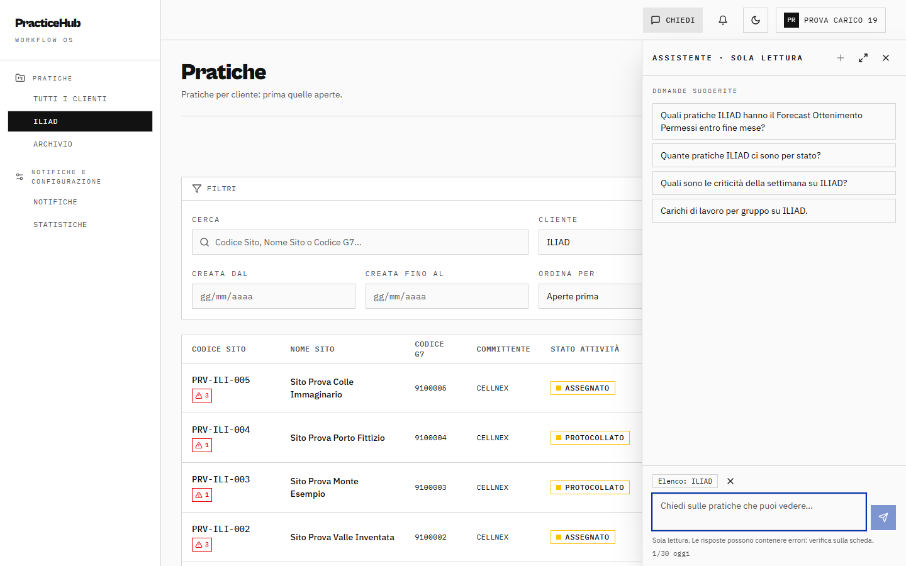
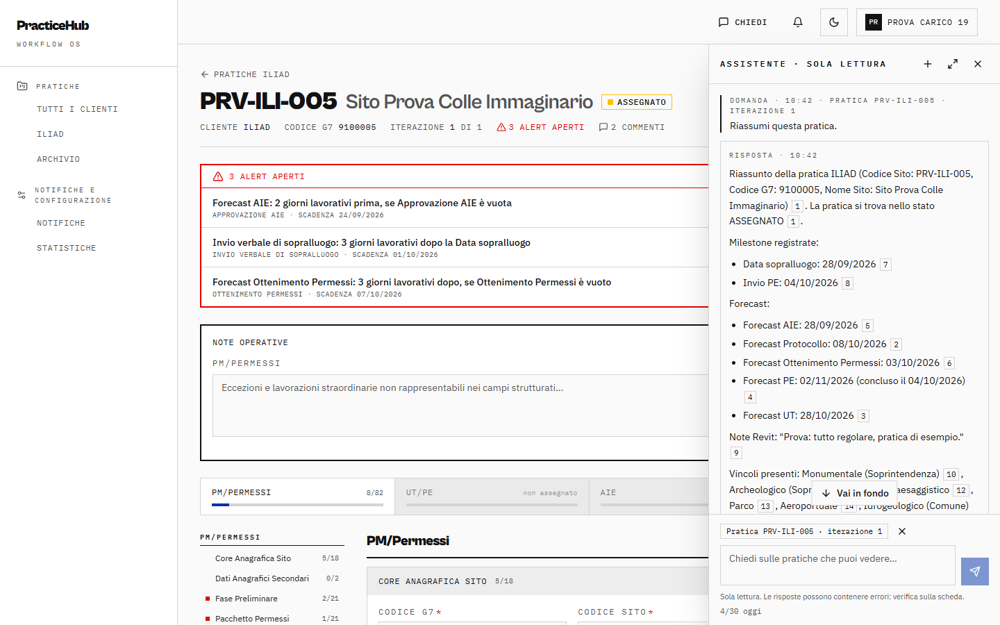

## 13. Andamento (amministratori e Direzione)

La pagina **Andamento** serve a capire come procede il lavoro e dove si blocca, anche nel lungo periodo. Risponde a tre domande: **dove si fermano le pratiche**, **il lavoro tiene il passo**, **come va nel tempo**. Parla sempre di **stati, gruppi e clienti, mai di persone**: non ci sono classifiche (il carico per persona resta in Statistiche).

**Chi la vede.** Gli amministratori e chi ha la casella **Direzione** (Configurazione → Utenti). Direzione **si aggiunge** al lavoro normale: un team leader con Direzione resta team leader e in più vede Andamento, le Statistiche e i Carichi di lavoro di tutti i clienti e gruppi; l'assistente gli risponde anche su questi dati. Chi ha solo Direzione, senza gruppi, entra direttamente su Andamento, vede solo Andamento, Notifiche e Statistiche e non modifica niente.

**Filtri.** In alto: **Cliente**, **Da / A**, **Periodo** (mese, trimestre, anno), **Passo** (settimana o mese) e **Confronto** (periodo precedente o stesso periodo dell'anno prima). I filtri finiscono nell'indirizzo: salvando la pagina nei preferiti si salva la vista. Sotto i filtri, **"Dati dal …"** dice da quando ci sono dati.

**I sei numeri in alto:** Attive ora, Entrate, Uscite, Arretrato (quanto è cambiato nel periodo), Ferme oltre la soglia, Tempo mediano delle pratiche terminate. Sotto ognuno, in piccolo, il confronto scritto.

> **Mediana e media.** La mediana è il valore «di mezzo»: metà delle pratiche ci mette meno, metà di più. Non si lascia trascinare da poche pratiche lunghissime, per questo è il numero principale; la media è accanto.

**Dove si fermano le pratiche**

- **Tempo per Stato attività:** per ogni stato, mediana, media, passaggi e pratiche ancora lì. Lo stato in cui le pratiche restano di più ha l'etichetta **PIÙ LENTO** e una frase sopra la tabella: è il primo candidato a collo di bottiglia, non una sentenza. Vale solo con almeno 5 passaggi; con meno, i valori sono grigi con l'asterisco ("poco indicativo"). **"Per data del fatto"** confronta il tempo con la data scritta nel campo: se è molto diverso, le date vengono inserite in ritardo.
- **Attese esterne e sospensioni:** DINIEGATO, TAR e STAND-BY hanno un riquadro a parte. Si vede quanto pesano, ma non sono mai «più lento» e non entrano nei tempi del lavoro operativo.
- **Tempo per gruppo** (UT/PE, AIE, DL): **tempo per partire** (dall'Assegna alla prima modifica del gruppo) e **tempo per la prima consegna** (dall'Assegna alla prima attività del gruppo completata). I tempi di PM/Permessi sono quelli degli stati.
- **Pratiche ferme:** le pratiche nello stesso stato da più della soglia (iniziale 30 giorni), per stato e per cliente, dalla più ferma. Il codice apre la scheda solo se quella pratica la puoi già vedere. Le pratiche ferme dall'import e quelle senza una data d'ingresso nello stato sono indicate a parte, mai nascoste.

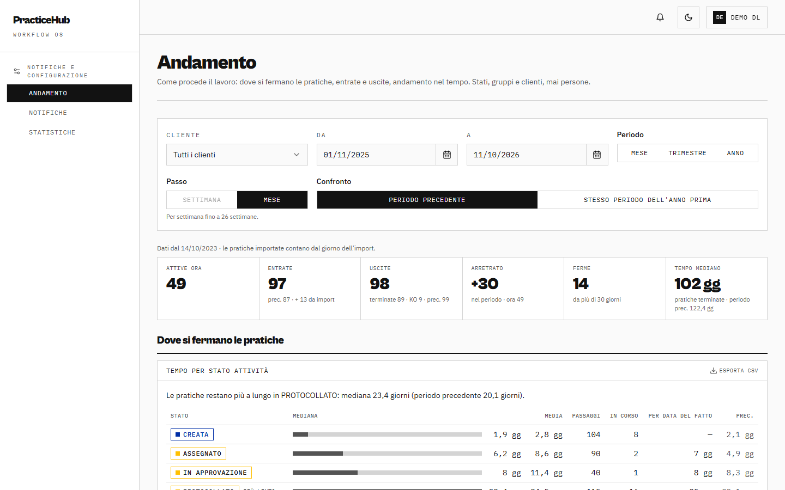
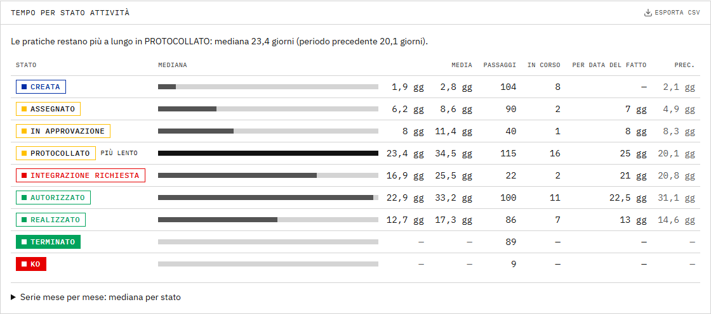
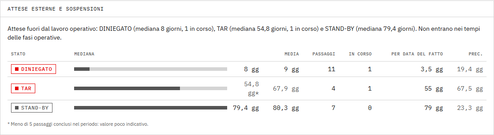
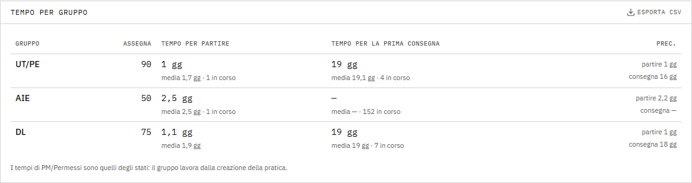
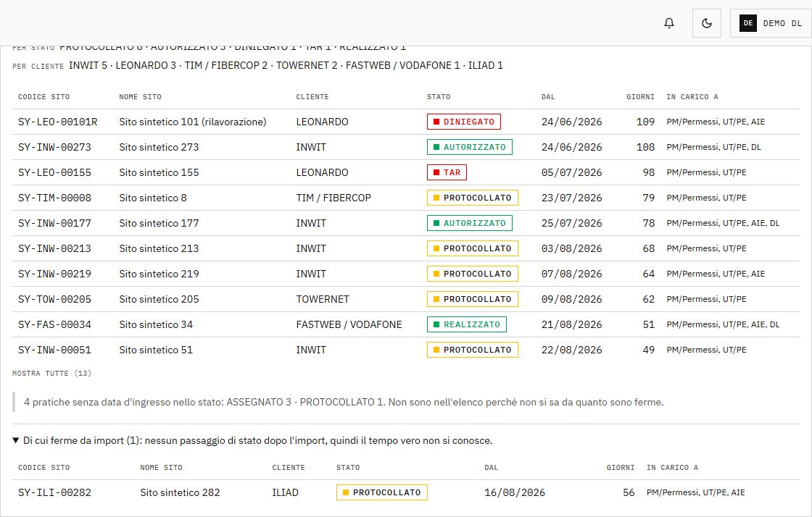

**Il lavoro tiene il passo?** Due grafici sugli stessi mesi: entrate e uscite, e sotto l'arretrato a fine mese. Se per mesi le uscite restano sotto le entrate, l'arretrato sale. Sotto c'è il conto intero ("123 all'inizio + 42 entrate … − 7 archiviate = 128 alla fine"); **Mostra come tabella** dà gli stessi numeri.

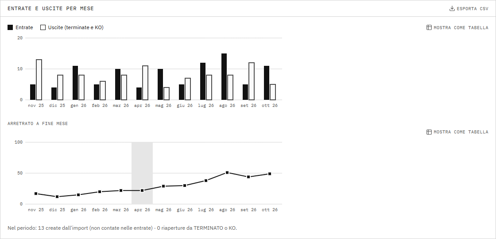

**Rilavorazioni e scadenze.** Quante pratiche vengono rilavorate o ripresentate, da quali stati, e i **ritorni a uno stato precedente** (dove nasce il lavoro rifatto). Per le scadenze: attività completate entro o oltre il forecast, forecast rinviati, forecast già passati senza completamento, e gli alert (aperti, chiusi, scaduti, ripetuti, tempo di chiusura).

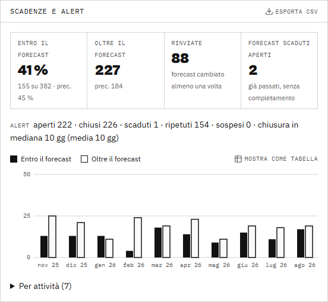

**Nel tempo.** Sotto i tempi per stato e le rilavorazioni c'è la **serie mese per mese**; con il **Confronto** si guarda il periodo prima o l'anno prima.

**Excel.** Ogni tabella ha il suo **Esporta CSV**; per le ferme il file le contiene tutte.

**Da sapere**

- I tempi contano **dal giorno della partenza**: nei primi mesi molti stati avranno pochi dati (valori grigi). Il tempo prima di un import non si conosce.
- Giorni di **calendario**, non lavorativi.
- I numeri si aggiornano **entro 5 minuti**.

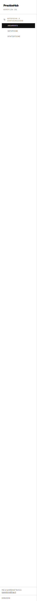
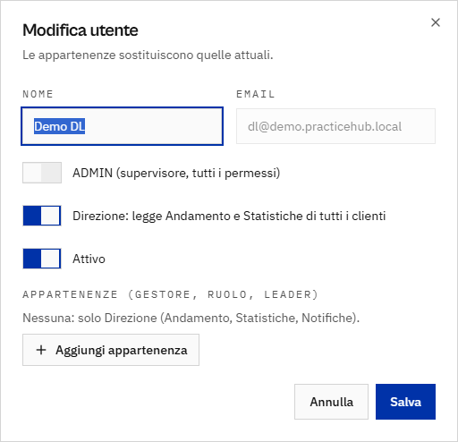

## 14. Domande frequenti

- **Non riesco a modificare un campo.** Guarda il motivo sotto il lucchetto: spesso il tuo gruppo non ha ancora ricevuto l'Assegna, o il campo è di un altro gruppo.
- **Un menu è vuoto.** Chiedi al team leader del tuo gruppo di aggiungere i valori in Configurazione → Liste.
- **Ho salvato ma dice che qualcuno ha modificato la pratica.** Un collega ha salvato prima di te: i dati sono stati ricaricati e le tue modifiche non salvate sono ancora lì; controlla e salva di nuovo.
- **Ho letto la notifica ma l'alert è ancora lì.** È normale: l'alert si chiude compilando il campo indicato (o a mano, dove previsto).
- **Altri problemi:** scrivi a **operations@hqe.it** indicando la pratica (Codice Sito) e cosa stavi facendo.
